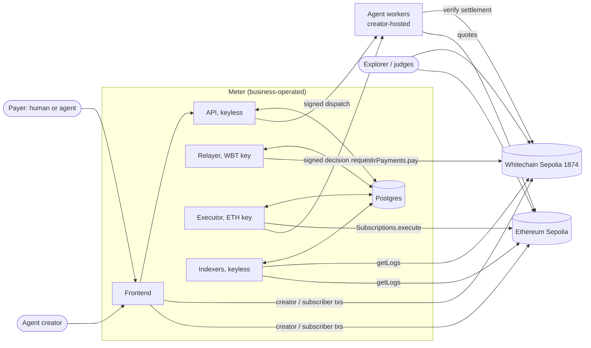
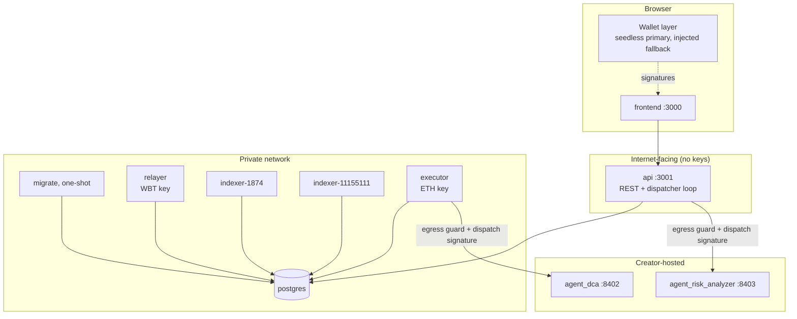
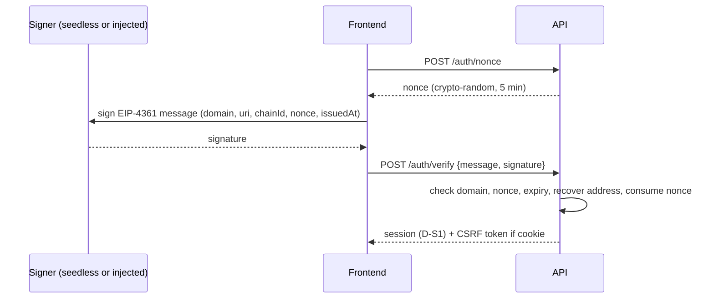
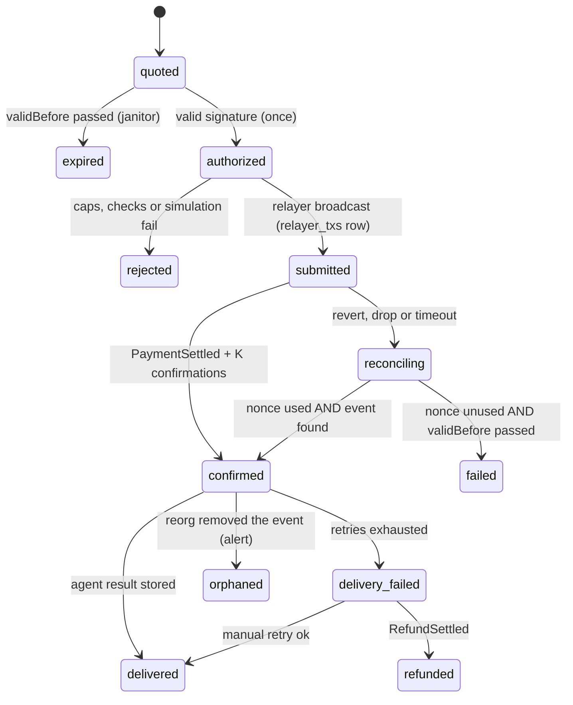

# ARCHITECTURE.md — Meter (v2)

Target architecture for **Meter**: the existing Daemon agent marketplace, extended with gasless USDT payments on **Whitechain** and real swaps on **Uniswap**.

- **Companion document:** [TRACK_IMPLEMENTATION.md](TRACK_IMPLEMENTATION.md). It holds the research, evidence, tasks (`S-`, `P-`, `W-`, `U-`), owners, decisions (`D-`) and blockers (`B-`).
- **Status: PROPOSED.** Nothing new described here has been built.
- **v2** is a self-audit of v1. §0 says what v1 got wrong and why each choice changed.

Tags used throughout:

| Tag | Meaning |
|---|---|
| `[EXISTING]` | In the repo at commit `2eeed81`, kept as is |
| `[CHANGED]` | In the repo, modified by this design |
| `[NEW]` | Does not exist yet |
| `[OPTIONAL]` | Stretch, gated by a decision |
| `[OPEN D-xx]` | Depends on an unresolved decision |
| `[v2]` | Added or changed by the audit |

---

## 0. Audit of v1

### 0.1 How the audit was done

I re-read v1 as an attacker, as an operator running it at 3 a.m., and as a judge checking the claims. I also re-checked the facts it rested on against the code and the chain:
- The indexer reads `latest` with no confirmation depth (`backend/src/indexer/indexer.ts`, `getBlockNumber`).
- Outbound calls go to creator-supplied `endpoint_url` with only a timeout (`backend/src/executor/executor.ts:71-118`, `backend/src/utils/fetchWithTimeout.ts`).
- No script ever sets a trust score, and the default `MIN_TRUST_SCORE` is 50 (`backend/src/config.ts:24`). Compose sets it to 0, so the gate is effectively off.
- The frontend already hints that a later Permit2 permit overwrites an earlier one (`frontend/lib/useSubscribeOnChain.ts:79-81`).
- Whitechain RPC (read-only, 2026-11-07): `latest` = block `0xbd24f5` while `safe` = `finalized` = `0xbd1e1e`. That is about **1,750 blocks ≈ 29 minutes** of lag.

### 0.2 Findings

| # | Severity | What v1 said or missed | Why it was wrong | v2 change |
|---|---|---|---|---|
| F1 | **High** | The agent worker verifies `PaymentSettled` and marks `payment_id` consumed | Payment events are public. Anyone watching the chain can call the worker with a fresh `payment_id` **before** Meter does. They get the result (possibly about the victim's wallet), and the real payer is refused. Paid results were stealable | Bind a `paramsHash` into the signed nonce **and** the event. The worker accepts only requests **signed by Meter's dispatch key** (a key holding no funds; agents verify against a published address). Result theft and parameter substitution both fail (§4.3, §6.2) |
| F2 | **High** | The relayer lives inside the API process (decision A6) | The internet-facing process held the only hot key, and it also makes outbound HTTP calls to creator URLs (SSRF surface). The in-memory nonce queue was lost on restart, so stuck transactions were undiscoverable | **The API holds no keys.** A separate `relayer` process claims `authorized` payments from Postgres (`FOR UPDATE SKIP LOCKED`) and persists every tx (nonce, hash, fees) in `relayer_txs`. On boot it reconciles against `getTransactionCount('pending')`. A6 reversed |
| F3 | **High** | Server-side calls to agent endpoints | `endpoint_url` is creator-controlled. The executor and API fetch it from inside the backend network, which reaches Postgres and internal services (SSRF) | An outbound HTTP guard: https only (http allowed only on an explicit dev allowlist); resolve DNS and block private, loopback, link-local and metadata ranges, and re-check the IP at connect; no redirects; timeouts and size caps. Applies to the API dispatcher and the executor (§10) |
| F4 | **High** | "Delivery is retried; payment stands" | If the agent is permanently broken, the payer has paid and gets nothing, with no remedy. v1 had no refund story | (a) **Preflight:** a free `POST /v1/preflight` validates params before a quote is issued. (b) **Refund path:** the creator signs an EIP-3009 authorization returning the value, and Meter relays it (no WBT for the creator). (c) Escrow is rejected because releasing it needs a trusted attestor. New decision **D-A2** (§6.6) |
| F5 | **Medium** | "Confirmed = receipt" and an indexer at `latest` | OP Stack unsafe blocks can reorg. With `safe`/`finalized` ~29 min behind, there is a trade-off v1 never stated | Two-tier finality: **delivery** after receipt + K confirmations (K per chain, **D-A4**); **accounting** (`runs.finality`) promoted to `final` when the `safe` head passes the block. The indexer reprocesses an overlap window and handles removed logs (§7.3) |
| F6 | **Medium** | "Indexer is the single writer of runs" | It fixes double counting, but the UX waits for the indexer poll (20 s) after the API already holds the receipt. The real fix is idempotency, not having one writer | **Idempotent writers keyed by event identity** `(chain_id, tx_hash, log_index)` with `INSERT … ON CONFLICT DO NOTHING`. Counters are derived from runs, never incremented separately. The relayer and indexer may both write; duplicates are impossible (§7.2) |
| F7 | **Medium** | Permit2 not analysed for multiple subscriptions | Permit2 `AllowanceTransfer.permit` **sets** (does not add) `amount` and `expiration` per (owner, token, spender). A second subscription overwrites the first's allowance and expiry. Funds stay safe, because `Subscriptions` enforces per-subscription amount, interval and expiry, but earlier subscriptions can starve or expire early. **Existing liveness bug** | **Corrected after v2 (see the note below this table):** v2 first proposed a budget-summed permit with expiry = the latest end date. That is wrong, because `subscribe` stores the permit expiration as the new subscription's own end date, so the new subscription would run longer than the user chose. The real fix is decision **D-A6**: (a) one active subscription per (subscriber, token, chain), or (b) a contract change adding an explicit `endTime ≤ permit expiration`, plus budget-summed permits. Task I-5 |
| F8 | **Medium** | Trust-score gating kept as `[EXISTING]` | Nobody sets scores, the gate reads one fixed `AGENT_ID`, and the default 50 blocks everything. Keeping it implied a reputation system that doesn't exist | Per-agent lookup `(chain_id, onchain_agent_id)`, **disabled by explicit config** for the hackathon, plus decision **D-A3** for who scores. No implied feature |
| F9 | **Medium** | Executor pays `/v1/decide`, then may revert on-chain | Insufficient balance, an exhausted Permit2 allowance or an expired subscription revert after the paid or authenticated decision call: wasted calls and gas | **Pre-checks before calling the agent:** due (on-chain), USDC balance, Permit2 `allowance(owner, token, Subscriptions)` amount and expiry, and an `eth_call` simulation of `execute` once params exist |
| F10 | **Medium** | Sessions described loosely | A custom login message has no domain binding (phishable), and cookies need CSRF handling | **SIWE (EIP-4361)** messages with domain, URI, chainId, nonce and issuedAt. httpOnly SameSite=Lax cookie plus a CSRF token, or a bearer token `[OPEN D-S1]`. CORS locked to the frontend origin |
| F11 | **Medium** | "Humans and agents pay agents", but only a browser flow was designed | Agent payers (programmatic clients) had no path | The payments API is the client protocol: SIWE session with a local key, then quote, sign, authorize, poll. Optional **x402 facade** `[OPTIONAL]`: `402` responses that carry a Meter quote |
| F12 | **Low** | Subscriber params in on-chain `subscribe` | Existing code writes the subscriber's form answers as hex JSON on-chain, publicly | Params stored off-chain in Postgres; only `keccak256(params)` goes on-chain |
| F13 | **Low** | Amounts stored as `NUMERIC(18,6)` decimal strings | Lossy for 18-decimal tokens and mixes formatting with storage | Store **base units** (`NUMERIC(78,0)`) plus a `token` reference with decimals from the registry; format only at the edge |
| F14 | **Low** | `MeterPayments` assumed `value` arrives intact | A fee-on-transfer or non-standard token would forward less than `value` | Measure the received balance delta and require it equals `value` |
| F15 | **Low** | No operations story | No metrics, alerts, health checks or runbooks for the most failure-prone parts (relayer balance, indexer lag, RPC limits) | New §11 *Operations*: health endpoints, metrics, alerts, runbooks |
| F16 | **Low** | No environment and test topology | Each developer would invent one. Also, B-W1 (no test USDT) seemed to block all contract testing | §12 *Environments*: local anvil forks of both chains. A Whitechain fork test can impersonate an existing USDT holder (INFERRED to work with the proxy), so **W-10 is not blocked by B-W1**; only the live demo is |
| F17 | **Low** | Agent output rendered in the UI | Agent output is untrusted third-party content (XSS) | Render as text/JSON only; never as raw HTML |
| F18 | **Low** | Per-chain indexing tuning missing | The Whitechain RPC allows 50 req/s; a fixed 10k-block chunk may exceed provider limits | Per-chain `startBlock`, `logChunkSize`, `confirmations` and `pollMs` in the chain registry |

**Note on F7 (found while writing the I-5 task spec).** The v2 fix for F7 repeated the mistake it was fixing: it reasoned about Permit2 alone and not about how `Subscriptions.subscribe` reads the permit (`permitExpiry = permitSingle.details.expiration`, `contracts/src/Subscriptions.sol`). That is the lesson here: any fix that touches a signed parameter must be traced through every contract that consumes it.

### 0.3 Questioning my own technical claims

| Claim in v1/v2 | Confidence | Basis | How it gets proven |
|---|---|---|---|
| EIP-3009 `receiveWithAuthorization` enforces `msg.sender == to` | High for the spec; **unverified for this Tether implementation** | EIP-3009 text; the implementation is verified source on Blockscout but that function body was not read by me | W-10: read the function in the verified source and add a test that a non-`to` caller reverts |
| The USDT EIP-712 domain is name "Tether USD", version "1" | Low–medium | `version()` and `eip712Domain()` revert, so INFERRED | W-03/W-10: recompute and match `DOMAIN_SEPARATOR` (`0xcdcf…2a25`) |
| MetaMask rejects typed data whose `chainId` ≠ the active chain | Medium–high | Reviewer recollection and known MetaMask behaviour; not tested here | W-01 prototype |
| SwapRouter02 `exactInputSingle` has no deadline | High | Read in `IV3SwapRouter.sol` by two independent agents | U-02 test |
| OP Stack blocks can reorg before `safe` | High in principle; rare in practice | OP Stack design (sequencer unsafe head); `safe` lag observed on chain | Design handles it regardless (F5) |
| A forked anvil test can move USDT on a proxy token | Medium | Standard Foundry practice (`vm.prank` as a holder); `deal` on proxies sometimes fails slot discovery | W-10: impersonation first, `deal` as backup |
| Permit2 `permit` overwrites rather than adds | High | Permit2 `AllowanceTransfer` design; consistent with the repo comment | Foundry test with two subscriptions (I-5) |
| Relayer gas per payment ≈ 0.0005–0.00065 WBT | Low (estimate) | Typical gas of an EIP-3009 call plus transfer at 5 gwei | Measure in W-03 |

---

## 1. What Meter is

Meter is a non-custodial marketplace where creators list AI agents and payers, whether people or other agents, pay those agents in stablecoins.

| Payment shape | Network | Settlement | Gas paid by | Track |
|---|---|---|---|---|
| **One-time paid run** | Whitechain Sepolia (1874) | Payer-signed EIP-3009 `receiveWithAuthorization` on the prize USDT, executed by `MeterPayments` | Business relayer (WBT) | Whitechain |
| **Recurring DCA subscription** | Ethereum Sepolia (11155111) `[OPEN D-U1]` | Permit2 pull by `Subscriptions.execute`, swapped by `UniswapV3SwapService` through Uniswap v3 SwapRouter02 | Executor (cycles); subscriber (subscribe/cancel) | Uniswap |
| Recurring on Whitechain `[OPTIONAL D-W2]` | Whitechain Sepolia | Relayed ERC-2612 permit, then Permit2, then `subscribeWithSig` | Business relayer | Whitechain (stretch) |

### Design principles

1. **Non-custodial.** Payer funds move only under the payer's signature. No contract holds user funds between transactions, except per-agent revenue awaiting the creator's withdrawal.
2. **The chain is the source of truth.** Money facts come only from confirmed event logs. Postgres is an index plus off-chain metadata.
3. **Idempotent by event identity.** Every money record has a natural key: `payment_id`, `(token, from, nonce)` or `(chain_id, tx_hash, log_index)`. Writers upsert; counters are derived. `[v2]`
4. **Fixed-function signing.** Signing processes call a short allowlist of contract functions and never forward client calldata.
5. **Keys live away from the internet edge.** Internet-facing processes hold no keys. Each key has exactly one job. `[v2]`
6. **Honest separation.** Whitechain and the Uniswap network are separate: separate balances, no bridge, no atomicity.
7. **Untrusted by default.** Creator endpoints, agent outputs and client inputs are untrusted. Agents trust the chain plus Meter's signed dispatch, not Meter's word alone. `[v2]`

---

## 2. System context



| Actor | Holds | Does |
|---|---|---|
| Payer | Seedless key `[OPEN D-W1]` (injected wallet as fallback), USDT on Whitechain | Signs SIWE and EIP-712 only; never needs WBT or a network setup |
| Programmatic payer (agent) `[v2]` | Its own key | Same API: SIWE, quote, sign, authorize, poll |
| DCA subscriber | Wallet with Sepolia USDC and ETH | Signs Permit2; sends `subscribe` / `cancel` |
| Creator | Wallet on the agent's chain | Registers, withdraws, signs refunds `[v2]` |
| Business | Relayer, executor, deployer and dispatch keys; Postgres | Operates Meter and funds gas |
| Agent worker | Payout address; Meter's published dispatch address `[v2]` | Verifies dispatch signature and settlement, then works |

---

## 3. Deployment topology



| Process | Status | Chain access | Signing key | Replicas | Notes |
|---|---|---|---|---|---|
| `migrate` | `[NEW]` | — | — | one-shot | Versioned, forward-only migrations (S-05) |
| `api` | `[CHANGED]` | Whitechain and Sepolia: read | **none** `[v2]` | ≥1 | REST, SIWE, quotes. The dispatcher loop claims `confirmed` payments with `SKIP LOCKED` and signs dispatch with `DISPATCH_SIGNING_KEY` (holds no funds) |
| `relayer` | `[NEW] [v2]` | Whitechain: read + write | `WHITECHAIN_RELAYER_PRIVATE_KEY` | **exactly 1** (one nonce sequence) | Claims `authorized` payments; persists `relayer_txs`; reconciles on boot; fee bump; caps |
| `indexer-<chainId>` | `[CHANGED]` | read | none | 1 per chain | Confirmation lag, overlap window, removed-log handling, finality promotion |
| `executor` | `[CHANGED]` | Sepolia: read + write | `EXECUTOR_PRIVATE_KEY` | exactly 1 | In-flight guard, pre-checks, persisted tx state |
| `agent_risk_analyzer` | `[CHANGED]` | Whitechain: read | none | — | Verifies dispatch signature and `PaymentSettled` |
| `agent_dca` | `[CHANGED]` | Sepolia: read | none | — | Verifies dispatch signature; QuoterV2 quotes |
| `frontend` | `[CHANGED]` | read + user txs | browser wallet | — | Public `NEXT_PUBLIC_*` only |
| `postgres` | `[EXISTING]` | — | — | 1 | Also serves as the work queue (no extra broker) |

**Why Postgres as the queue:** every hand-off (`authorized → relayer`, `confirmed → dispatcher`) is a row state change claimed with `SELECT … FOR UPDATE SKIP LOCKED`. That gives at-most-one processing, survives restarts, and adds no infrastructure. `LISTEN/NOTIFY` wakes workers to cut polling latency.

---

## 4. On-chain architecture

### 4.1 Whitechain Sepolia (1874)

| Contract | Status | Role |
|---|---|---|
| USDT `0xcedfB56113143d55b2358b8CFbB0dEB5Ad2f55a7` | external | Prize token, 6 decimals; EIP-3009 and ERC-2612 in source (**signed calls not yet simulated**); has a blocklist |
| **`MeterPayments`** | `[NEW]` (W-10) | One-time settlement and creator refunds `[v2]` (§4.3) |
| `Subscriptions` | `[EXISTING]`; `[CHANGED]` if D-W2 | Optional `subscribeWithSig` / `cancelWithSig` |
| `ServiceFactory`, `ServiceDeployer`, `Service` | `[EXISTING]` | Registration, per-agent revenue; deployed from the tagged commit after CP3 |
| `ERC8004IdentityRegistry`, `ERC8004ValidationRegistry` | `[EXISTING]` | Identity NFT; scores `[OPEN D-A3]` |
| Permit2 | external preinstall | Only for the optional subscriptions |

### 4.2 Ethereum Sepolia — Uniswap network `[OPEN D-U1]`

| Contract | Status | Role |
|---|---|---|
| `Subscriptions` | `[EXISTING]` | Per-subscription amount, interval and expiry enforcement; Permit2 pull |
| **`UniswapV3SwapService`** | `[NEW]` (U-02) | Fee, then typed `exactInputSingle`, then min-out and deadline checks, then WETH to the subscriber, then `SwapExecuted` (§4.4) |
| `ServiceFactory` / `ServiceDeployer` | `[CHANGED]` (U-03) | `createUniswapSwapService`; ABI frozen at CP3 |
| `SIPService` | `[EXISTING]`, superseded | Not deployed on the Uniswap network |
| SwapRouter02 `0x3bFA…`, QuoterV2 `0xEd1f…`, USDC/WETH 0.05% pool `0x3289…`, USDC `0x1c7D…`, WETH `0xfff9…` | external | Official Uniswap and Circle deployments (TRACK §4) |

### 4.3 `MeterPayments` specification `[NEW]` (revised in v2)

```solidity
event PaymentSettled(bytes32 indexed paymentId, address indexed from, address indexed payee,
                     uint256 value, bytes32 paramsHash);
event RefundSettled(bytes32 indexed paymentId, address indexed payee, address indexed payer, uint256 value);

function pay(bytes32 paymentId, address from, address payee, uint256 value, bytes32 paramsHash,
             uint256 validAfter, uint256 validBefore, bytes calldata signature) external {
    bytes32 nonce = keccak256(abi.encode("PAY", paymentId, payee, value, paramsHash, block.chainid, address(this)));
    uint256 before = USDT.balanceOf(address(this));
    USDT.receiveWithAuthorization(from, address(this), value, validAfter, validBefore, nonce, signature);
    require(USDT.balanceOf(address(this)) - before == value);   // F14
    USDT.safeTransfer(payee, value);
    emit PaymentSettled(paymentId, from, payee, value, paramsHash);
}

function refund(bytes32 paymentId, address payee, address payer, uint256 value,
                uint256 validAfter, uint256 validBefore, bytes calldata signature) external {   // F4
    bytes32 nonce = keccak256(abi.encode("REFUND", paymentId, payer, value, block.chainid, address(this)));
    // payee (creator) signed ReceiveWithAuthorization{from: payee, to: this, value, nonce}
    ... receive from payee, forward to payer, emit RefundSettled
}
```

| Property | Mechanism |
|---|---|
| Payee, value, paymentId and params can't be altered | All are hashed into the signed nonce; any change produces a different nonce, so the signature check fails |
| No front-running | `receiveWithAuthorization` requires `msg.sender == to` (spec; **verify in Tether source, W-10**) |
| No replay | The token marks `(from, nonce)` used; `"PAY"`/`"REFUND"` prefixes separate the two domains; `chainid` and `address(this)` prevent cross-deployment replay |
| Holds no funds | Receive and forward happen in one transaction, with an exact-amount check |
| Permissionless | Anyone holding a valid signature can submit; the relayer is the usual submitter |
| Refunds without WBT | The creator signs; Meter relays (same caps) |

### 4.4 `UniswapV3SwapService` specification `[NEW]`

```solidity
execute(subscriber, tokenIn, amount, params) onlySubscriptions nonReentrant whenNotPaused
  (tokenOut, poolFee, amountOutMinimum, deadline) = abi.decode(params)
  require(block.timestamp <= deadline && allowedTokenOut[tokenOut] && allowedFee[poolFee] && amountOutMinimum > 0)
  feeAmount = min(amount * fee / 10_000, maxFeeAmount > 0 ? maxFeeAmount : ∞)
  amountIn  = amount - feeAmount                          // fee kept; withdraw() → feeReceiver
  forceApprove(router, amountIn); router.exactInputSingle({.., recipient: this, amountIn, amountOutMinimum, 0}); forceApprove(router, 0)
  out = balanceDelta(tokenOut); require(out >= amountOutMinimum)
  transfer(tokenOut, subscriber, out)
  emit SwapExecuted(subscriber, tokenIn, tokenOut, amountIn, out, feeAmount)
```

Residual trust: the executor chooses `amountOutMinimum`, because there is no on-chain oracle. On a mainnet version, MEV would also need private submission; that is out of scope on testnet.

---

## 5. Off-chain architecture

### 5.1 Backend modules

| Module | Path | Status | Responsibility |
|---|---|---|---|
| Chain registry | `backend/src/config.ts`, `chain/client.ts`, `api/chain.ts` | `[CHANGED]` | `ChainConfig { chainId, name, rpcUrl, explorerTxUrl, nativeSymbol, manifestPath, startBlock, logChunkSize, confirmations, pollMs }` `[v2 fields]`; keys loaded only on request |
| Egress guard `[v2]` | `backend/src/utils/egress.ts` (new) | `[NEW]` | SSRF-safe fetch: scheme allowlist, DNS check against private ranges, no redirects, timeout, body cap |
| SIWE auth | `backend/src/api/routes/auth.ts` + middleware | `[CHANGED]` | EIP-4361 verify; session `[OPEN D-S1]`; CSRF if cookie |
| Payments API | `backend/src/api/routes/payments.ts` | `[NEW]` | Preflight `[v2]`, quote, authorize, status, refund request `[v2]` |
| Dispatcher `[v2]` | `backend/src/api/dispatcher.ts` (new) | `[NEW]` | Claims `confirmed` payments; signs a dispatch envelope; calls the agent through the egress guard; stores the result; retries with backoff |
| Relayer `[v2: own process]` | `backend/src/relayer/` | `[NEW]` | Claims `authorized` payments; caps; simulation; fixed builders; `relayer_txs` persistence; fee bump; reconcile on boot |
| Indexer | `backend/src/indexer/indexer.ts` | `[CHANGED]` | Per chain; processes up to `latest − confirmations`; re-scans an overlap window; handles `removed` logs; promotes finality from the `safe` head; idempotent upserts |
| Scheduler / executor | `backend/src/scheduler/`, `executor/` | `[CHANGED]` | In-flight guard; **pre-checks** `[v2]`; signed decision request; persisted tx state; fee bump |
| x402 client | `backend/src/x402/client.ts` | `[CHANGED]` | No standing max approvals; no unsigned headers (P-04) |
| Migrations | `backend/src/db/` | `[CHANGED]` | Versioned, one-shot |

### 5.2 Dispatch envelope `[v2]` (Meter → agent)

```
POST <endpoint>/v1/invoke
Headers: X-Meter-Dispatch: <EIP-191 signature by the dispatch key over the canonical JSON body>
Body: { "v": 1, "chainId": 1874, "paymentId": "0x…", "txHash": "0x…",
        "params": {…}, "paramsHash": "0x…", "issuedAt": 1730956800, "expiresAt": 1730956860 }
```

The agent does the work only if **all** of these hold:
1. The signature recovers to Meter's published dispatch address (from the manifest or `GET /config`).
2. `expiresAt` has not passed.
3. `keccak256(canonical(params)) == paramsHash`.
4. The receipt for `txHash` contains `PaymentSettled(paymentId, *, <its payee>, ≥ <its price>, paramsHash)` from the manifest's `MeterPayments`, with ≥ K confirmations.
5. `paymentId` has not been consumed before.

Steps 1–2 stop strangers stealing results. Steps 3–5 stop Meter from inventing payments or swapping parameters.

`agent_dca` uses the same envelope for `/v1/decide` (no payment fields), so the executor authenticates to it without a shared secret. This resolves D-U3 by default; the only remaining choice is whether the decision is also paid.

### 5.3 Agent interface (for third-party creators)

| Endpoint | Required? | Purpose |
|---|---|---|
| `POST /v1/preflight` `[v2]` | Recommended | Free parameter validation; no work done. Return 2xx (ok) or 4xx with a reason |
| `POST /v1/invoke` | Required (one-time agents) | Signed dispatch (§5.2); returns JSON result |
| `GET /health` | Recommended | Liveness check, used to hide unhealthy agents in the marketplace |

### 5.4 Frontend

| Area | Status | Notes |
|---|---|---|
| Wallet layer | `[CHANGED]` `[OPEN D-W1]` | Seedless primary with chain 1874 defined in-app; injected fallback (network prompt) |
| Pay-per-run | `[CHANGED]` | preflight → quote → sign → authorize → poll → render the result **as text/JSON only** `[v2]` |
| Refund request `[v2]` | `[NEW]` | Payer sees "delivery failed"; the creator console offers "sign refund" |
| DCA subscribe | `[CHANGED]` | Multiple subscriptions handled per D-A6 (one-per-token guard, or `endTime` + budget-summed permit) `[OPEN D-A6]`; params hashed on-chain `[v2 F12]` |
| Creator console | `[CHANGED]` | Chain per mode; refunds `[v2]`; withdraw |
| Faucet | `[CHANGED]` | Mock `mint` removed |

---

## 6. Key flows

### 6.1 Sign-in (SIWE) `[v2]`



### 6.2 One-time paid run (primary Whitechain demo)

```mermaid
sequenceDiagram
  participant U as Payer
  participant FE as Frontend
  participant API as API (keyless)
  participant DB as Postgres
  participant REL as Relayer
  participant MP as MeterPayments
  participant AG as Agent

  FE->>API: POST /payments/preflight {agent_id, params}
  API->>AG: /v1/preflight (egress guard)
  AG-->>API: ok
  FE->>API: POST /payments/quote {agent_id, params}
  API->>DB: payment quoted (payee, value, paramsHash, nonce, validBefore)
  API-->>FE: payment_id + typed data
  FE->>U: sign ReceiveWithAuthorization
  U-->>FE: signature
  FE->>API: POST /payments/{id}/authorize
  API->>DB: quoted → authorized (conditional, once); NOTIFY
  REL->>DB: claim authorized (SKIP LOCKED), check caps
  REL->>MP: eth_call simulate pay(...)
  REL->>DB: relayer_txs row (nonce, fees) then submitted
  REL->>MP: pay(...) [WBT]
  REL->>DB: receipt + K confirmations → confirmed; run upserted
  API->>DB: dispatcher claims confirmed (SKIP LOCKED)
  API->>AG: signed dispatch envelope
  AG->>MP: verify PaymentSettled (+ paramsHash, payee, value, confirmations)
  AG-->>API: result
  API->>DB: delivered
  FE->>API: GET /payments/{id} (poll)
  API-->>FE: result (rendered as text/JSON) + explorer link
```

| Item | Party |
|---|---|
| Signs | Payer (typed data only) |
| Broadcasts and pays WBT | Relayer (business) |
| Receives USDT | `payee` `[OPEN D-W3]` |
| Payer setup transactions | **None** |
| Payer funding | Out of band. The demo distributor sends USDT; a real on-ramp is out of scope. **Funding is a visible step in the real world**, disclosed in limitations `[v2]` |

### 6.3 Creator registers an agent

1. The creator's wallet calls `registerAgent` (one-time → Whitechain) or `createUniswapSwapService` (DCA → Uniswap network). The creator pays gas.
2. The frontend posts the receipt hash. **The API re-reads the receipt** and checks that the event matches the session address before inserting the agent `[CHANGED]`.
3. The indexer backstop fills any missing fields from factory events.
4. The agent card URI must be resolvable and chain-qualified `[OPEN D-A1]`.
5. The creator's endpoint must pass the egress guard at registration (https, public IP) and `GET /health` `[v2]`.

### 6.4 DCA subscription and cycle (Uniswap network)

```mermaid
sequenceDiagram
  participant S as Subscriber
  participant FE as Frontend
  participant API as API
  participant SUB as Subscriptions
  participant EX as Executor
  participant AG as agent_dca
  participant SVC as UniswapV3SwapService
  participant IX as Indexer

  FE->>API: remaining budgets of active subs (same token)
  FE->>S: approve USDC→Permit2 once; sign PermitSingle (sizing per D-A6)
  S->>SUB: subscribe(service, USDC, amount, interval, permit, sig, keccak(params))
  SUB-->>IX: SubscriptionCreated → active

  loop each tick (skip if in flight)
    EX->>SUB: getSubscription → due?
    EX->>EX: pre-checks: USDC balance, Permit2 allowance amount + expiry
    EX->>AG: signed /v1/decide
    AG-->>EX: quote(post-fee amountIn), quotedAt, slippageBps, amountOutMinimum
    EX->>EX: quote ≤ 30 s old; deadline = now + window (D-U4)
    EX->>SUB: eth_call simulate execute(id, params)
    EX->>SUB: execute(...) [persisted nonce]
    SUB->>SVC: pull via Permit2, swap, send WETH
    SVC-->>IX: SwapExecuted → run upsert, finality promoted later
  end
```

### 6.5 Withdraw and cancel

- **Cancel:** `Subscriptions.cancel(id)` sets expiry to now; the indexer marks it cancelled. Any residual Permit2 allowance is harmless, because `Subscriptions` won't pull for a cancelled ID. The UI offers an optional allowance revoke.
- **Withdraw:** `Service.withdraw(token)` by the creator; the indexer records the event.

### 6.6 Delivery failure and refund `[v2]` `[OPEN D-A2]`

1. The dispatcher retries with backoff (for example 3 attempts over 10 minutes), then marks `delivery_failed`.
2. The payer sees the failure. The creator is notified in the console.
3. The creator signs `ReceiveWithAuthorization{from: creator, to: MeterPayments, value, nonce = REFUND hash}`. The relayer calls `refund`, which emits `RefundSettled`. The payment status becomes `refunded`.
4. If the creator doesn't refund, the agent is flagged and hidden after N unrefunded failures. This is reputation, not enforcement, and is disclosed as a limitation.

---

## 7. Data architecture

### 7.1 Tables

| Table | Status | Key columns / constraints |
|---|---|---|
| `users` | `[EXISTING]` | `user_address` unique (chain-agnostic EOA) |
| `auth_nonces` | `[CHANGED]` | Crypto-random; SIWE fields |
| `sessions` | `[NEW]` if server-side (D-S1) | `session_id`, `user_id`, `expires_at`, `csrf_token` |
| `tokens` `[v2]` | `[NEW]` | `(chain_id, address)` PK, `symbol`, `decimals`; seeded from manifests |
| `agents` | `[CHANGED]` | + `chain_id`, `payout_address`, `health_status`; unique `(chain_id, onchain_agent_id)` |
| `subscriptions` | `[CHANGED]` | + `chain_id`, `params_json`, `params_hash`; unique `(chain_id, onchain_sub_id)` |
| `payments` | `[NEW]` | `payment_id` PK; `chain_id`, `token`, `from_address`, `payee`, `value_base` NUMERIC(78,0), `auth_nonce`, `params_json`, `params_hash`, `valid_before`, `status`, `attempts`, `result_json`, `error`, timestamps; unique `(chain_id, token, from_address, auth_nonce)` |
| `relayer_txs` `[v2]` | `[NEW]` | `id`, `chain_id`, `from_address`, `nonce`, `tx_hash`, `max_fee`, `status` (`sent`/`replaced`/`mined`/`dropped`), `payment_id`; unique `(chain_id, from_address, nonce, tx_hash)` |
| `relayer_usage` | `[NEW]` | Daily counters per session, IP and global, including reverted relays |
| `runs` | `[CHANGED]` | + `chain_id`, `log_index`, `payment_id`, `finality` (`confirmed`/`final`/`orphaned`) `[v2]`; amounts in base units; unique `(chain_id, tx_hash, log_index)` |
| `withdrawals`, `refunds` `[v2]` | `[CHANGED]`/`[NEW]` | Same event-identity uniqueness |
| `chain_cursors` `[v2]` | `[NEW]` | `chain_id` PK, `last_processed_block`, `last_safe_block` (replaces `system_constants` checkpoints) |
| `schema_migrations` | `[NEW]` | Applied versions |

### 7.2 Write rules `[v2]`

- Money rows (`runs`, `withdrawals`, `refunds`) are inserted with `ON CONFLICT (chain_id, tx_hash, log_index) DO NOTHING` by **any** writer that holds the confirmed log. In practice that is the relayer (fast path) and the indexer (backstop).
- Counters (`usage_count`, earnings) are **derived** by query or materialized view from `runs`. Nothing increments them independently. This removes the double-count class of bug.
- State machines (`payments`, `relayer_txs`) advance only through conditional updates (`UPDATE … WHERE status = $expected`).

### 7.3 Finality and reorgs `[v2]`

| Stage | Rule (per chain, from the registry) | Used for |
|---|---|---|
| `confirmed` | Receipt plus K confirmations at `latest` (`D-A4`, e.g. K = 5 on Whitechain ≈ 5 s, 3 on Sepolia) | Delivery, UI |
| `final` | Block ≤ RPC `safe` head (observed ~29 min lag on Whitechain) | Earnings, analytics |
| `orphaned` | The log comes back with `removed: true`, or is missing on re-scan of the overlap window | Flag the run; alert; never deliver twice |

The indexer re-scans the last `confirmations × 2` blocks each pass to catch reorgs.

---

## 8. State machines

### 8.1 Payment `[v2]`



Invariants:
- Money moves at most once per `payment_id`.
- Delivery is attempted only from `confirmed`.
- A refund is possible only from `delivery_failed`.

### 8.2 Relayer transaction `[v2]`

`created → sent → (replaced → sent)* → mined | dropped`. On boot: compare the DB with `getTransactionCount(pending/latest)`, re-broadcast or replace any stuck `sent` rows, and never reuse a nonce.

### 8.3 Subscription and executor cycle

- **Subscription:** `pending → active → cancelled | expired`.
- **Executor cycle:** `idle → in_flight → submitted → mined | reverted → idle`. Runs are written by event identity, not by the cycle.

---

## 9. API surface

| Endpoint | Status | Auth |
|---|---|---|
| `POST /auth/nonce`, `/auth/verify` (SIWE) | `[CHANGED]` | public |
| `GET /config` (registry public data, dispatch address) | `[CHANGED]` | public |
| `GET /agents`, `/agents/:agent_id` (with `chain_id`, `health_status`) | `[CHANGED]` | public |
| `GET /agents/:chain_id/:onchain_agent_id/card.json` | `[CHANGED]` `[OPEN D-A1]` | public |
| `POST /payments/preflight` `[v2]` | `[NEW]` | session |
| `POST /payments/quote` | `[NEW]` | session |
| `POST /payments/:id/authorize` | `[NEW]` | session = `from` |
| `GET /payments/:id` | `[NEW]` | owner |
| `POST /payments/:id/refund-authorization` `[v2]` | `[NEW]` | session = creator of the agent |
| `GET /subscriptions/budget?chain_id&token` `[v2]` | `[NEW]` | session (remaining budgets for permit sizing) |
| `POST /subscriptions`, `/:id/cancel` | `[CHANGED]` | session |
| `POST /user/*`, `/creator/*` | `[CHANGED]` | session |
| `POST /agents/:agent_id/invoke`, `POST /agents/runs` | **removed** | — |

---

## 10. Security architecture

### 10.1 Trust boundaries

| Boundary | Crossing | Control |
|---|---|---|
| Browser/agent client → API | HTTP | SIWE session, CSRF (cookie), CORS to the frontend origin, rate limits (trusted-proxy aware) |
| API → creator endpoints | Outbound HTTP | Egress guard; signed dispatch; timeouts; body caps; output treated as untrusted |
| Executor → `agent_dca` | Outbound HTTP | Same |
| Relayer/executor → chains | Signed txs | Fixed builders, manifest allowlist, simulation, caps, persisted nonces |
| Agent → chain | Reads | Settlement verified independently of Meter |
| Frontend ← agent output | Rendering | Text/JSON only |

### 10.2 Threats and controls

| Threat | Control | Task |
|---|---|---|
| Unauthorized USDT spend | Signed nonce binds payee, value, paymentId and paramsHash; enforced on-chain | W-10 |
| Payment replay | Token nonce; DB unique; consumed `paymentId` at the agent | W-04, W-05, W-10 |
| **Result theft or param substitution at the agent** `[v2]` | Dispatch signature + `paramsHash` in the event | W-05, I-1, I-1b |
| Front-running | `receiveWithAuthorization` (`msg.sender == to`) | W-10 |
| Relayer gas drain | Global daily cap, min payment value, per-session/IP limits, reverted relays counted, simulation, max gas price, WBT-only key, alerts | W-02, W-04 |
| **Hot key exposed at the edge** `[v2]` | Keys only in the private relayer/executor processes | I-2 |
| **SSRF via creator endpoints** `[v2]` | Egress guard on all outbound agent calls | I-3 |
| **Paid but undelivered** `[v2]` | Preflight; retries; creator-signed refund | I-4a, I-4b |
| Arbitrary call / swap | Fixed builders; typed swap service | W-04, U-02 |
| Impersonation / phishing login | SIWE with domain binding | P-01 |
| Agent drained via unsigned headers | Removed (P-04); dispatch signature instead | P-04 |
| Double execution, nonce collisions, stuck txs | In-flight guard; persisted tx state; fee bump; boot reconcile | P-03, I-2 |
| Double accounting / reorgs | Event-identity upserts; derived counters; finality tiers; overlap re-scan | P-02, I-6 |
| **Permit2 overwrite starves earlier subs / stretches new ones** `[v2]` | D-A6: one-per-token guard, or `endTime` + budget-summed permit | I-5 |
| XSS from agent output `[v2]` | Text-only rendering | W-05 |
| Secret leakage | Per-role keys; public-only `NEXT_PUBLIC_*`; old keys and endpoints not reused | S-04 |

### 10.3 Key inventory

| Key | Process | Holds | If leaked | Rotation |
|---|---|---|---|---|
| `WHITECHAIN_RELAYER_PRIVATE_KEY` | relayer | WBT only | Attacker can spend WBT; **cannot move user USDT** | New key, refill, restart; no on-chain role |
| `EXECUTOR_PRIVATE_KEY` | executor | Sepolia ETH | Attacker can trigger due cycles with a bad `amountOutMinimum` (bounded by the subscriber's per-cycle amount) | `setExecutor(new, true)`, `setExecutor(old, false)` |
| `DISPATCH_SIGNING_KEY` `[v2]` | api | **nothing** | Attacker can request work from agents, **but only for real, unconsumed on-chain payments with matching params** | Publish the new address in the manifest; agents refresh |
| `WHITECHAIN_DEPLOYER_PRIVATE_KEY` | local only | WBT; contract ownership | Owner actions on Meter contracts | Transfer ownership |
| User keys | user devices / seedless provider | Their own funds | — | D-W1 |

---

## 11. Operations `[v2]`

| Signal | Source | Alert when |
|---|---|---|
| Relayer WBT balance | relayer | Below 24 h of projected spend |
| Relayer queue depth / oldest `authorized` age | DB | > 30 s |
| Stuck `relayer_txs` (`sent` too long) | DB | > 60 s; auto fee bump, then alert |
| Indexer lag per chain (`latest − cursor`) | indexer | > 2 × poll interval |
| Orphaned runs | indexer | Any |
| Executor failures by reason (pre-check, revert, quote stale) | executor | Sustained rate |
| Delivery failures per agent | dispatcher | > N per hour; agent auto-hidden |
| RPC 429/5xx | all | Sustained; back off and rotate to a secondary RPC (D-A5) |

- **Health:** `GET /healthz` per process (DB reachable, RPC reachable, cursor freshness).
- **Logs:** structured pino with correlation IDs: `payment_id`, `subscription_id`, `tx_hash`.
- **Runbooks:** relayer out of WBT; stuck nonce; RPC outage; reorg orphan; agent down; refund handling.

---

## 12. Environments and testing `[v2]`

| Environment | Chains | Purpose |
|---|---|---|
| Unit | none | Contract unit tests (mock EIP-3009 token, mock router); backend unit tests (D-S2) |
| Fork | `anvil --fork-url` for Whitechain and Sepolia | W-10 against the real USDT by impersonating an existing holder (works without B-W1; INFERRED); U-02 against the real pool |
| Local stack | Compose + two anvil forks | End-to-end without spending testnet funds |
| Testnet | Whitechain Sepolia + Ethereum Sepolia | Demo; needs B-W1 resolved for live USDT |

---

## 13. Decisions

### 13.1 Fixed by this design

| # | Decision | Reason | Rejected |
|---|---|---|---|
| A1 | `MeterPayments` with `receiveWithAuthorization`, nonce binding payee, value, paymentId and paramsHash | On-chain binding, no front-running, verified contract in the demo | Plain `transferWithAuthorization`; ERC-4337 (no infrastructure); Permit2 only (hidden approve) |
| A2 | Uniswap on a separate supported testnet | No official Uniswap on Whitechain | Self-deployed fork, WhiteSwap, bridge |
| A3 | SwapRouter02 `exactInputSingle` from a typed service contract | Contract caller, plain approve | Universal Router, Trading API calldata |
| A4 `[v2]` | **Idempotent event-identity writes and derived counters** (replaces "single writer") | Fast UX and no double counting | Single writer (slow), executor writes (wrong data) |
| A5 | One indexer per chain | Isolation | One multi-chain loop |
| A6 `[v2 reversed]` | **Relayer as its own single-instance process; API keyless** | Key isolation, crash recovery, SSRF separation | Relayer inside the API (v1) |
| A7 | `chain_id` on every on-chain reference | IDs collide across chains | Database per chain |
| A8 `[v2]` | **Postgres as the work queue** (`SKIP LOCKED` + `LISTEN/NOTIFY`) | No extra infrastructure; durable | Redis or message broker |
| A9 `[v2]` | **Signed dispatch envelope to agents** | Stops result theft; authenticates the executor without shared secrets | Shared HMAC per agent (secret distribution), unauthenticated calls (v1) |
| A10 `[v2]` | **Two-tier finality** | `safe` lags ~29 min; can't gate delivery on it | Deliver at `latest`, or wait for `safe` |

### 13.2 Open (see TRACK §12)

| ID | What changes |
|---|---|
| D-W1 | Wallet layer and recovery |
| D-W2 | Whitechain subscriptions and an executor for 1874 |
| D-W3 | Payee: EOA or `Service` |
| D-W4 | A platform fee leg in `MeterPayments` |
| D-W5 | Cap values |
| D-U1 | Ethereum Sepolia vs Base Sepolia |
| D-U3 | Narrowed: the decision is authenticated by dispatch signature; only "also paid?" remains |
| D-U4 | Quote age and deadline |
| D-S1 | Session storage |
| D-A1 | Agent card URI scheme |
| **D-A2** `[v2]` | Refund policy: creator-signed refunds (proposed) vs no refunds; retry budget; auto-hide threshold |
| **D-A3** `[v2]` | Trust score: who scores, the threshold, or disable gating (proposed for hackathon: disabled, stated in README) |
| **D-A4** `[v2]` | Confirmation depth K per chain |
| **D-A5** `[v2]` | Secondary RPC per chain (e.g. Ankr's Whitechain entry) for failover |
| **D-A6** `[v2]` | Multiple subscriptions per (subscriber, token): one-per-token guard vs `Subscriptions` contract change (`endTime`) |

---

## 14. Mapping to the implementation plan

| Element | Tasks |
|---|---|
| Chain registry (incl. finality fields), per-role keys | S-04, S-04b |
| Migrations, chain-aware schema, `payments`, `relayer_txs`, `relayer_usage`, `tokens`, `chain_cursors` | S-05 |
| SIWE sessions, CSRF, CORS | P-01 |
| Idempotent writes, derived counters | P-02 |
| Scheduler guard, persisted nonces, pre-checks | P-03 |
| Remove unsigned agent payments | P-04 |
| `MeterPayments` (pay + refund) | W-10 |
| Relayer process, payments API | W-04 |
| Pay-per-run, dispatcher, worker verification | W-05 |
| Wallet layer | W-01, W-06 |
| Deploy and verify Whitechain | W-08 |
| `UniswapV3SwapService`, factory | U-02, U-03 |
| Quoter decision | U-04 |
| Executor and indexer for swaps | U-05 |
| DCA frontend | U-06 |
| Signed dispatch envelope; verifiers in both agents | I-1, I-1b |
| Relayer process, persisted tx state, fee bump, boot reconcile | I-2 |
| Egress guard (SSRF) | I-3 |
| Preflight; creator-signed refunds | I-4a; I-4b (BLOCKED, D-A2) |
| Multiple subscriptions per token | I-5 (BLOCKED, D-A6) |
| Finality tiers, reorgs, `chain_cursors` | I-6 |
| Operations | I-7a, I-7b |
| Agent card URI | I-8 (BLOCKED, D-A1) |

---

## 15. Out of scope and known limitations

- Mainnet; bridging; gas sponsorship on the Uniswap network; Uniswap v4, hooks, the Trading API, UniswapX; on-chain price oracles; MEV protection.
- **Payer funding is a visible step:** getting USDT into a new seedless wallet needs an on-ramp or a transfer. The demo uses a distributor.
- **Refunds depend on the creator:** they are enforced by reputation (auto-hide), not by escrow.
- The executor is trusted to choose `amountOutMinimum`.
- Injected wallets need a network prompt; a browser-held key (if chosen) can't be recovered.
- Testnet prices are arbitrary; DCA output is WETH.
- Trust-score gating is disabled until D-A3 is resolved.
